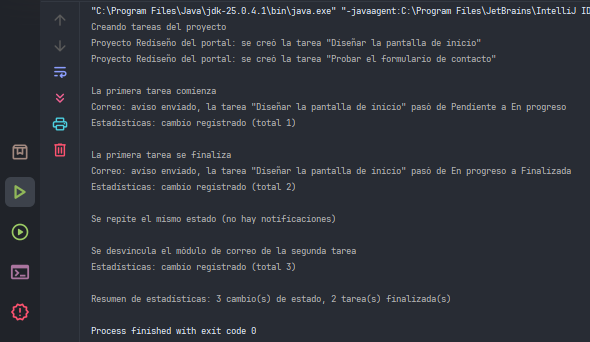

# Ejercicio 08 - Refactorización de Código Acoplado hacia el Patrón Observer

## Descripción

Una aplicación heredada de gestión de proyectos tiene una clase de tareas que llama directamente al módulo de correo y al de estadísticas. Cualquier cambio en esos módulos obliga a modificar la tarea y puede romper el código principal. Se refactoriza hacia el patrón Observer.

## Objetivos

- Eliminar las referencias directas a servicios concretos dentro de la tarea.
- Convertir la tarea en sujeto observable y los módulos en observadores independientes.
- Aplicar abstracción e inversión de control.
- Dejar a la tarea con la única responsabilidad de gestionar su estado y notificar.

## Implementación del patrón Observer

**Antes (acoplado):** la tarea crea y llama directamente a los módulos.

```java
public class Task {
    private final EmailNotifier emailNotifier = new EmailNotifier();
    private final StatisticsModule statisticsModule = new StatisticsModule();

    public void changeStatus(TaskStatus newStatus) {
        this.status = newStatus;
        emailNotifier.sendEmail(title, newStatus);
        statisticsModule.register(title, newStatus);
    }
}
```

**Después (Observer):**

- **Sujeto:** `Task` guarda su estado y una lista de `TaskListener`. Al cambiar de estado, crea un `TaskEvent` y notifica.
- **Observador:** `TaskListener` declara `onTaskStatusChanged(TaskEvent event)`.
- **Observadores concretos:** `EmailNotifier` y `StatisticsModule`.
- **Inversión de control:** `Project` recibe la lista de oyentes por constructor y los agrega a cada tarea que crea. Solo conoce la interfaz `TaskListener`.
- **Composición:** únicamente `Main` conoce los módulos concretos.

## Propósito de la clase

- `TaskStatus`: estados de la tarea.
- `TaskEvent`: evento inmutable con el cambio de estado.
- `TaskListener`: abstracción que reemplaza las dependencias directas.
- `Task`: sujeto observable.
- `Project`: clase de negocio que crea tareas con oyentes inyectados.
- `EmailNotifier`: módulo de avisos por correo.
- `StatisticsModule`: módulo de estadísticas.
- `Main`: arma la composición, cambia estados y desvincula un oyente.

## Concepto clave

Se invierte la dependencia: la tarea ya no depende de los módulos concretos, sino de una interfaz. Agregar, quitar o cambiar un módulo no requiere tocar la clase `Task`.

## Resultado



## Conclusión

La refactorización reduce el acoplamiento y respeta el principio abierto/cerrado. La tarea se limita a gestionar su estado y los módulos pueden evolucionar o reemplazarse sin romper el código principal.
